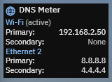

# ClaudeCodeProjects

Small projects built with Claude Code.

| Project | What it is |
| --- | --- |
| [DNS Meter](#dns-meter) | A Rainmeter gadget, in the style of ModernGadgets, that shows the DNS servers set on your network adapters |

---

## DNS Meter

A [Rainmeter](https://www.rainmeter.net/) gadget that shows the IPv4 DNS servers configured on up to four network adapters. It's built as an add-on for [ModernGadgets](https://github.com/raiguard/ModernGadgets) by raiguard, so it uses the suite's own stylesheet and follows your ModernGadgets colours, fonts, scale and background settings.



### Features

- **Up to four interfaces.** Pick them in a DNS Meter Settings window, the same way Network Meter's interface slots work.
- **Status at a glance.** Each interface is labelled **(active)** when it carries your internet traffic, **(disconnected)** when it's unplugged, or **(not found)** when the adapter no longer exists.
- **Manual or automatic DNS.** It shows manually set DNS servers, or the ones handed out by DHCP when the adapter is set to automatic.
- **Near-instant updates.** DNS values are read from the registry every second, so a manual DNS change appears almost immediately.
- **Automatic fallback.** With no interfaces chosen, it shows whichever adapter is currently active.

### Requirements

- Windows 10 or 11 (uses the built-in `NetAdapter`, `NetTCPIP` and `DnsClient` PowerShell modules)
- Rainmeter 4.5 or newer
- [ModernGadgets](https://github.com/raiguard/ModernGadgets) installed (DNS Meter loads its `@Resources`)

### Installation

1. Copy the [`DnsMeter`](DnsMeter) folder into your ModernGadgets skins folder, so you end up with:
   ```
   Documents\Rainmeter\Skins\ModernGadgets\DnsMeter\
     DnsMeter.ini
     DnsMeter.lua
     DnsSettings.inc
     Settings\
       DnsMeterSettings.ini
       DnsMeterSettings.lua
   ```
   It must sit next to the other gadgets (`CpuMeter`, `NetworkMeter`, ...), not in a separate skin folder.
2. Right-click the Rainmeter tray icon and choose **Refresh all**.
3. Load it from the tray menu: **Skins → ModernGadgets → DnsMeter → DnsMeter.ini**.

### Usage

- **Choose interfaces:** click the gadget, or right-click it and choose **DNS Meter settings**.
  - In each slot, left-click to move to the next adapter and right-click to go back. `(none)` is part of the cycle.
  - **x** clears a slot.
  - Changes apply to the gadget right away.
- **Edit by hand:** the choices are stored in `DnsSettings.inc`. Each slot accepts an adapter name (`Wi-Fi`, `Ethernet 2`) or its full description (`Realtek PCIe 2.5GbE Family Controller`):
  ```ini
  [Variables]
  dnsInterface1=Wi-Fi
  dnsInterface2=Ethernet 2
  dnsInterface3=
  dnsInterface4=
  ```
  The `DnsSettings.inc` in this repo comes with `Wi-Fi` and `Ethernet 2` filled in. Change those to your own adapters, or clear them to show the active adapter.
- **Re-detect adapters:** hover over the gadget and click the refresh arrow, or use **Re-detect interfaces** in the right-click menu.

### How it works

- **Finding adapters:** a PowerShell command (run through Rainmeter's RunCommand plugin) lists your adapters, their status and which one owns the lowest-metric default route. It runs when the gadget loads, when the active adapter or IP address changes, and every 60 seconds as a fallback (`ifRecheckSeconds` in `DnsMeter.ini`).
- **Reading DNS:** each chosen adapter's DNS servers are read from `HKLM\SYSTEM\CurrentControlSet\Services\Tcpip\Parameters\Interfaces\{GUID}`:
  - `NameServer` holds manually set DNS servers.
  - `DhcpNameServer` holds DNS servers supplied by DHCP. These are only shown while the adapter is connected.

### Limitations

- IPv4 DNS servers only.
- Shows the first two DNS servers of each adapter.
- Shows the DNS configured in Windows. If you change DNS on your router, Windows won't pick it up until the DHCP lease renews (`ipconfig /renew` forces it).

### Credits

DNS Meter is built on, and depends on, **[ModernGadgets](https://github.com/raiguard/ModernGadgets)** by **[raiguard](https://github.com/raiguard)** (Caleb Heuer). Its look, layout conventions, stylesheet, settings and refresh button icons, and settings-window design all come from ModernGadgets. DNS Meter is an unofficial add-on and is not affiliated with or endorsed by the ModernGadgets project.

## License

[MIT](LICENSE.md). DNS Meter includes portions derived from ModernGadgets, © 2016-2018 raiguard, also under the MIT License. Both notices are in [LICENSE.md](LICENSE.md).
